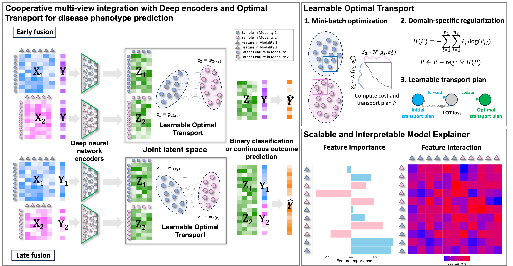
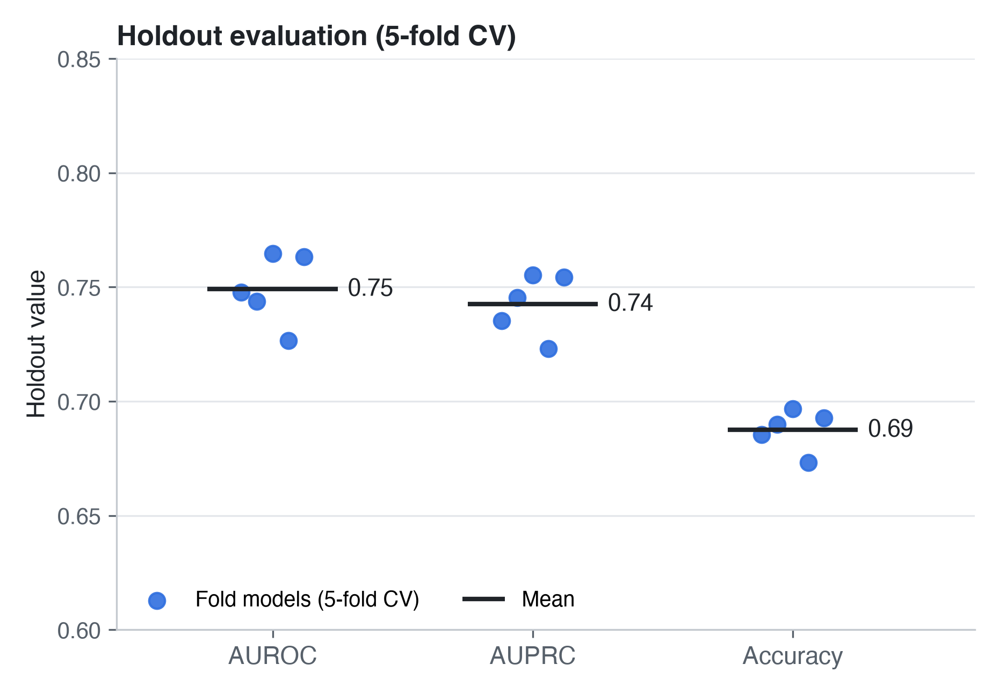
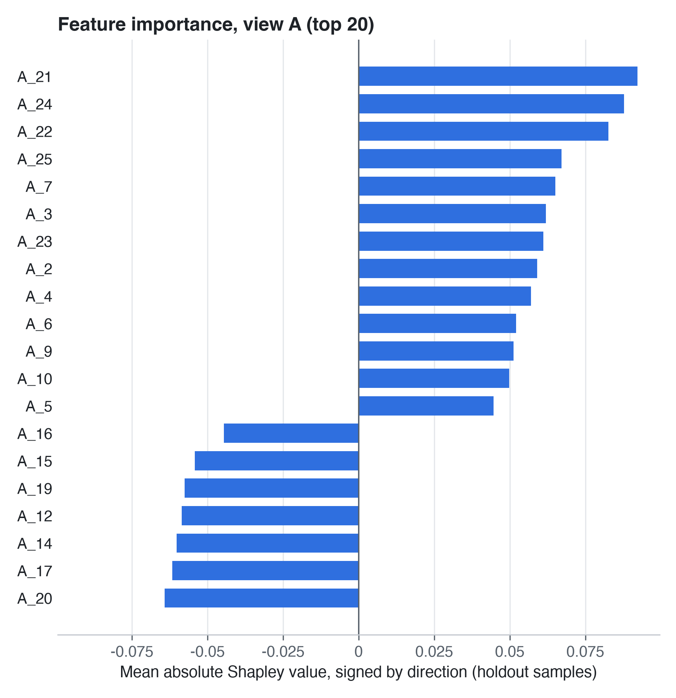
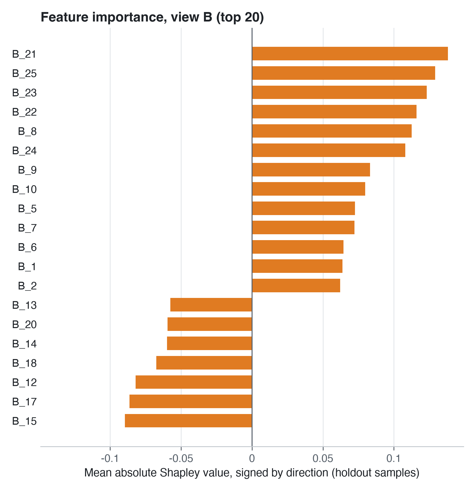
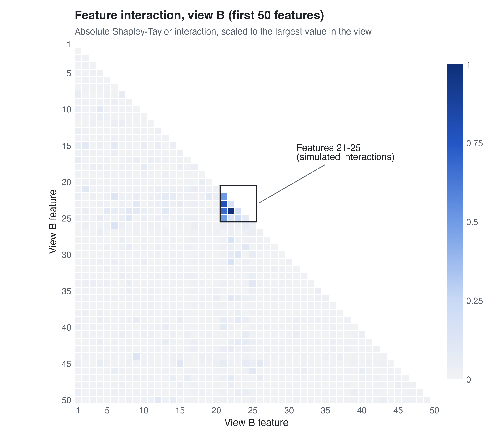

# COSIME: Cooperative multi-view integration with a Scalable and Interpretable Model Explainer

Cooperative Multiview Integration with a Scalable and Interpretable Model Explainer (COSIME) is a machine learning model that integrates multi-view data for disease phenotype prediction and computes feature importance and interaction scores. By leveraging deep learning-based encoders, COSIME effectively captures the complex, multi-layered interactions between different omic modalities while preserving the unique characteristics of each data type. The integration of LOT techniques aligns and merges heterogeneous datasets, improving the accuracy of modeling across-view relationships in the joint latent space. In addition, COSIME leverages the Shapley-Taylor Interaction Index to compute feature importance and interaction values, allowing for a deeper understanding of how individual features and their interactions contribute to the predictions.



## Installation
1. Clone and navigate to the respository.
```bash
git clone https://github.com/jeromejchoi/COSIME.git
cd COSIME
```
2. Create and activate a virtual environment for python 3.10.14 with `conda` or `virtualenv`.
```bash
# conda
conda create -n COSIME python=3.10.14
conda activate COSIME

# virtualenv
source COSIME/bin/activate
COSIME\Scripts\activate
```
3. Install dependencies for production and development with `pip`.
```bash
pip install -r requirements.txt
pip install -r requirements-dev.txt
```
#### Estimated time of installing:
- About 2~3 minutes for requirements and requirements-dev, respectively on an Apple M1 Max with 10 physical cores and 32 GB of Unified Memory.

## Example: Simulated data (Binary outcome - high signal & late fusion)
### Simulated Data
The example data ([Example/binary_high_late_x1.csv](Example/binary_high_late_x1.csv), [Example/binary_high_late_x2.csv](Example/binary_high_late_x2.csv)) are generated with [Data/Simulation/simulate_data.py](Data/Simulation/simulate_data.py).
```bash
cd Example
python ../Data/Simulation/simulate_data.py
```
- Two views (A and B), each with its own 3,000 samples (late fusion) and 100 features from a standard normal distribution.
- Features 1-10: positive linear effects (0.3); features 11-20: negative linear effects (-0.3).
- Features 21-25: positive linear effects (0.5) and pairwise interactions among themselves (1.0 for each pair).
- Features 26-100: noise.
- Binary outcome: drawn from a Bernoulli distribution with the logistic of the sum of the effects.
- Options: **--n** (samples per view), **--features**, **--beta**, **--block-beta**, **--w** (interaction), **--outcome** (binary or continuous), **--seed**, **--prefix** (output file names).

### Training and Predicting
All settings are in a YAML file ([Code/Model/COSIME.yml](Code/Model/COSIME.yml)). Relative paths are resolved from the repository root.
```bash
python Code/Model/main.py --config Code/Model/COSIME.yml
```
#### Parameters Overview (COSIME.yml)

##### Input Data (data)
- **mode**: single (one view) or multi (two or more views).
- **modalities**: One entry per view, with its name and the path to its CSV file. Early fusion: the same samples in every view, matched by sample ID. Late fusion: each view has its own samples and outcome.
- **outcome_column**: Name of the outcome column.
- **id_column**, **first_column_is_id**: Sample-ID column; by default the first column.
- **holdout_indices** (optional, late fusion): Holdout rows of each view, one CSV file of row positions per view (1-based by default, set with **holdout_indices_base**). By default each view is split at random.

##### Model Configuration (model)
- **type**: Outcome type, either binary (classification) or continuous (regression).
- **predictor**: Prediction head, regression or NN.
- **fusion**: Fusion method (early or late). Late fusion: each view has its own holdout and folds (fold k of every view is used together), and its predictions are compared with its own outcomes.
- **dim**: Size of the joint latent space where multiple views are represented.
- **dropout**: Probability of randomly dropping neurons during training to prevent overfitting.

##### Learnable Optimal Transport (lot)
- **reg**, **reg_m**: Entropic regularization and marginal relaxation.
- **num_iterations**: Number of LOT iterations.
- **batch_size**: Samples per OT block; null uses full-batch LOT.
- **domain_regularization**: Entropy adjustment of the transport plan (true or false).

##### Training Settings (training)
- **batch_size**: Number of samples processed in one pass.
- **epochs**: Number of training epochs.
- **optimizer**: adam or adamw.
- **learning_rate**: Controls how much weights are adjusted during training.
- **learning_gamma**: Factor the learning rate is multiplied by when the validation loss stops improving.
- **lr_factor**, **lr_patience** (optional): Learning rate x lr_factor after lr_patience epochs without improvement (defaults: learning_gamma and earlystop_patience).
- **earlystop_patience**: Number of epochs to wait without improvement before stopping training.
- **delta**: Minimum improvement required to reset early stopping counter.
- **decay**: Weight decay.
- **splits**: Number of folds for cross-validation.
- **holdout_fraction**: Share of samples kept out for holdout evaluation.
- **seed**, **cv_seed**: Random seeds for training and the holdout split, and for the cross-validation folds.
- **device**: Device to run the model (auto, cpu or cuda).

##### Loss Weights (loss)
- **kld_1_weight**: Weight for the KLD loss (view A).
- **kld_2_weight**: Weight for the KLD loss (view B).
- **ot_weight**: Weight for the LOT loss.
- **cl_weight**: Weight for the prediction loss.

##### Outputs (output)
- **directory**: Folder for the outputs: the final model (best_model.pt; after cross-validation, the model is refit on all training samples for the number of epochs of the best fold, and evaluated on the holdout: final_holdout.csv, final_holdout_predictions.csv), the best model of each fold, training history (history.csv), validation and holdout metrics of each fold (fold_metrics.csv), holdout evaluation of each fold (holdout_history.csv: each loss part and the metrics; binary outcomes: accuracy at 0.5 and at the best-F1 threshold, AUROC, AUPRC), holdout predictions, and the processed holdout data for the explainer (FI_holdout_processed.csv).


#### Results
<p style="text-align: left;">
  
</p>
<p style="text-align: left;">
  Holdout AUROC, AUPRC and accuracy of the model of each fold (5-fold CV)
</p>

#### Estimated time of running:
- About 2 minutes (5-fold cross-validation and refit) on an Apple M4 Pro with 12 cores and 24 GB of Unified Memory.


### Computing Feature Importance and Interaction
All settings are in a YAML file ([Code/Explainer/COSIME_FI.yml](Code/Explainer/COSIME_FI.yml)). The explainer uses the trained model and the processed holdout data written by training.
```bash
python Code/Explainer/COSIME_FI.py --config Code/Explainer/COSIME_FI.yml
```
#### Parameters Overview (COSIME_FI.yml)

##### Input Data and Model
- **data.paths**: Processed holdout data (FI_holdout_processed.csv, written by training).
- **model.best_model_path**: Trained model (best_model.pt).

##### Feature Importance (feature_importance)
- **enabled**: Compute Shapley values (true or false).
- **permutations**: Number of Monte Carlo permutations.
- **seed**: Random seed.
- **mask**: Value a masked feature takes: mean (mean over the samples; the most common value for features with fewer than 4 distinct values) or zero.

##### Feature Interaction (interaction)
- **enabled**: Compute pairwise feature interactions (true or false).
- **method**: shapley_taylor (Shapley-Taylor Interaction Index) or integrated_hessian (Integrated Hessians).
- **permutations**: Number of Monte Carlo permutations (shapley_taylor).
- **integration_steps**: Number of quadrature points per integral (integrated_hessian).
- **seed**: Random seed.

##### Late Fusion (late_fusion)
- When the views share no samples, independent pairs of samples (one per view) are drawn: **pairing_seed**, **num_reference_pairs**.

##### Compute and Outputs
- **compute.device**: Device to run the explainer (auto, cpu, cuda or mps).
- **compute.batch_size**: Number of samples processed together in one forward pass through the model.
- **output.directory**: Folder for the outputs: FI_matrix.csv (Shapley value of each feature for each sample), interaction_matrix.csv (mean pairwise interaction over samples; the diagonal is zero) and reference.csv (the values masked features take).

  
#### Results
|  |  |
|:-------------------------------------------------:|:-------------------------------------------------:|
| Top 20 features by mean absolute Shapley value; negative: higher values lower the prediction (View A) | Top 20 features by mean absolute Shapley value; negative: higher values lower the prediction (View B) |

|  |  |
|:-------------------------------------------------:|:-------------------------------------------------:|
| Absolute pairwise feature interactions (Shapley-Taylor) for the first 50 features (View A) | Absolute pairwise feature interactions (Shapley-Taylor) for the first 50 features (View B) |

#### Estimated time of running:
- About 13 minutes on an Apple M4 Pro with 12 cores and 24 GB of Unified Memory with compute.device: cpu (feature importance: 6 seconds; feature interaction: 13 minutes).


## References
Dhamdhere, K., Agarwal, A. & Sundararajan, M. The Shapley Taylor Interaction Index Ver- sion Number: 2. (2019).
